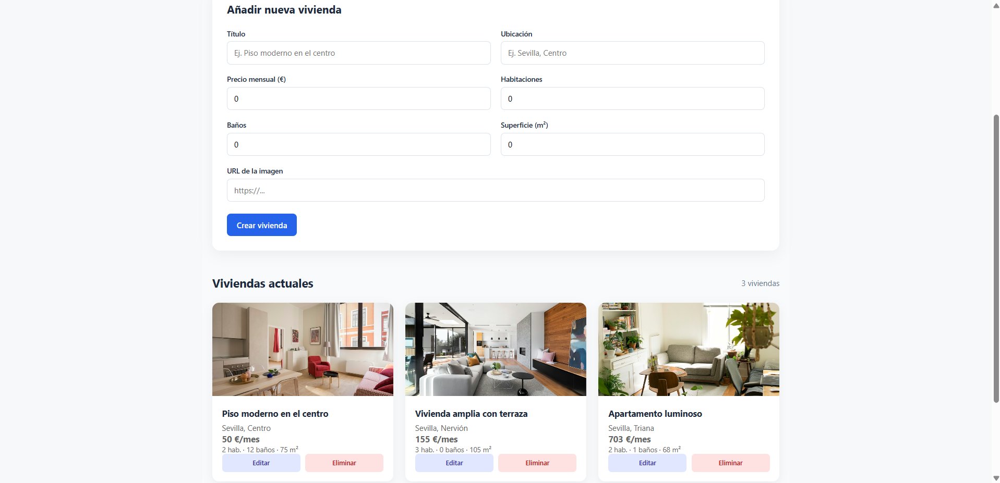

# 🏠 HomeFinder

> Full-stack real estate web application for browsing properties and managing listings through an authenticated administration panel.


---

## 📸 Screenshots

 #### Home / Search
 
 
 #### Login
 
  
 #### Administration
 

---

## 📖 About the project

HomeFinder is a full-stack web application designed to explore property listings and manage them through an administration panel.

I built this project to practise full-stack development, connecting a React and TypeScript frontend with a REST API developed using Java and Spring Boot, backed by a PostgreSQL database.

---

## ✨ Features

*  Browse available properties.
*  View individual property details.
*  User login with JWT authentication.
*  Protected administration panel.
*  Create new property listings.
*  Edit existing property listings.
*  Delete property listings.
*  PostgreSQL database integration.
*  Responsive interface for mobile and desktop screens.
*  Environment-based configuration for sensitive credentials.

---

## 🛠️ Tech stack

| Layer           | Technologies                     |
| --------------- | -------------------------------- |
| **Frontend**    | React, TypeScript, Vite, CSS     |
| **Backend**     | Java 21, Spring Boot, Spring Web |
| **Security**    | Spring Security, JWT, BCrypt     |
| **Persistence** | Spring Data JPA, Hibernate       |
| **Database**    | PostgreSQL                       |
| **Tooling**     | Git, GitHub, npm, Maven          |

---

## 🚀 Getting started

### Prerequisites

Make sure you have installed:

* Node.js and npm
* Java 21
* PostgreSQL
* Maven, or the Maven Wrapper included with the project

### 1. Clone the repository

```bash
git clone https://github.com/AdriRoB03/HomeFinder.git
cd HomeFinder
```

### 2. Set up the database

Create a PostgreSQL database named `homefinder`:

```sql
CREATE DATABASE homefinder;
```

The application uses the following local database configuration:

* Database: `homefinder`
* Username: `postgres`
* Port: `5432`

Make sure PostgreSQL is running before starting the backend.

### 3. Configure environment variables

The backend reads the database password and JWT signing secret from environment variables.

In Windows PowerShell, set them in the terminal where you will run Spring Boot:

```powershell
$env:DB_PASSWORD = "your_database_password"
$env:JWT_SECRET = "your_base64_encoded_secret"
```

Replace these example values with your own development credentials and a securely generated Base64-encoded secret.

**Important:** Never commit real passwords, JWT secrets or other sensitive credentials to Git.

### 4. Run the backend

Open a terminal in the project root:

```powershell
cd backend
```

If the project includes the Maven Wrapper, run:

```powershell
.\mvnw.cmd spring-boot:run
```

Otherwise, use Maven:

```powershell
mvn spring-boot:run
```

The backend API will be available at:

`http://localhost:8080`

You can check the health endpoint at:

`http://localhost:8080/api/health`

Keep this terminal open while using the application.

### 5. Run the frontend

Open a second terminal in the project root:

```powershell
cd frontend
npm install
npm run dev
```

Open the local URL displayed by Vite in your terminal, usually:

`http://localhost:5173`

The frontend communicates with the backend API at `http://localhost:8080/api`.

---

## 🔐 Environment variables

| Variable      | Description                    | Example                      |
| ------------- | ------------------------------ | ---------------------------- |
| `DB_PASSWORD` | PostgreSQL database password   | `your_database_password`     |
| `JWT_SECRET`  | Secret used to sign JWT tokens | `your_base64_encoded_secret` |

The database URL and username are configured in `backend/src/main/resources/application.properties`.

The frontend API URL is configured in the frontend source code.

For security, sensitive values are supplied through environment variables rather than stored directly in the repository.

---

## 📡 API overview

The backend exposes REST endpoints for health checks, property management and authentication.

| Method   | Endpoint               | Description                |
| -------- | ---------------------- | -------------------------- |
| `GET`    | `/api/health`          | Check backend availability |
| `GET`    | `/api/properties`      | Retrieve property listings |
| `GET`    | `/api/properties/{id}` | Retrieve a property by ID  |
| `POST`   | `/api/properties`      | Create a property          |
| `PUT`    | `/api/properties/{id}` | Update a property          |
| `DELETE` | `/api/properties/{id}` | Delete a property          |
| `POST`   | `/api/auth/login`      | Authenticate a user        |

Property management operations are intended to be performed through the protected administration functionality.

---

## 🧠 Technical decisions & challenges

* **Frontend and backend separation:** React and TypeScript handle the user interface, while Spring Boot exposes the API and manages business logic.
* **Relational persistence:** PostgreSQL stores property data, with Spring Data JPA and Hibernate handling database interactions.
* **JWT authentication:** JSON Web Tokens support authenticated requests and access to protected administration features.
* **Credential management:** Database passwords and JWT secrets are configured through environment variables to avoid hardcoding sensitive values in the repository.

